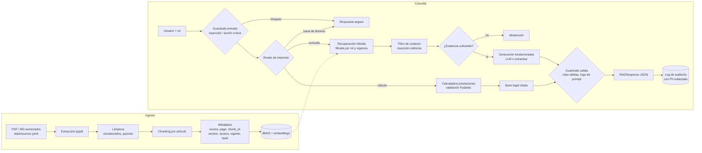

# Asistente Laboral GT — Sistema NLP/RAG Agéntico

Proyecto final de **CC3103 Procesamiento de Lenguaje Natural** (UVG, 2026).

Asistente de consulta sobre la **normativa laboral de Guatemala** (Código de Trabajo, Bono 14 y Aguinaldo) para colaboradores y personal de RR.HH. Responde con **citas verificables** (fuente, página y chunk), **se abstiene** cuando no hay evidencia y usa una **calculadora de prestaciones** determinista cuando la pregunta pide un monto.

> Es una herramienta de apoyo: no sustituye asesoría legal.

## Arquitectura



| Módulo | Función |
|---|---|
| `laboral_rag/ingest.py` | Pipeline reproducible: carga → extracción → limpieza → chunking por artículo → metadatos → índice |
| `laboral_rag/retrieval.py` | BM25 (línea base), denso y **híbrido (RRF)**; filtro por rol y vigencia; boost a identificadores exactos (“artículo 82”) |
| `laboral_rag/agent.py` | Orquestador con estado (`Trace`), router, límites de llamadas y degradación controlada |
| `laboral_rag/tools/prestaciones.py` | Aguinaldo, Bono 14, vacaciones e indemnización |
| `laboral_rag/guardrails.py` | Inyección directa e indirecta, acciones críticas, validación de citas, redacción de PII |
| `laboral_rag/llm.py` | Generación intercambiable: `extractive`, `ollama`, `openai`, `groq`, `gemini` |
| `laboral_rag/schemas.py` | Contratos Pydantic (`Chunk`, `RAGResponse`, `EvalCase`) |
| `eval/` | Banco de pruebas (31 casos) y benchmark automatizado |

### Formato de salida (contrato)

```json
{
  "answer": "string",
  "sources": [{"source": "codigo_de_trabajo.pdf", "page": 34, "chunk_id": "codigo_de_trabajo::0142"}],
  "abstained": false,
  "tool_used": null,
  "needs_human_review": false
}
```

## Instalación

```bash
python -m venv .venv && source .venv/bin/activate
pip install -r requirements.txt
cp .env.example .env        # elegir LLM_PROVIDER y, si aplica, la API key
```

Descarguen los PDF públicos a `data/raw/` según `data/README.md`.

## Uso

```bash
python -m laboral_rag.ingest                                   # construye el índice
python -m laboral_rag.agent "¿Cuántos días de vacaciones me corresponden?"
python -m laboral_rag.agent "Calcula mi aguinaldo: gano Q5,000 desde 01/03/2026" --trace
python -m laboral_rag.agent --role rrhh                        # modo interactivo como RR.HH.
streamlit run app/streamlit_app.py                             # interfaz web para la demo
```

La interfaz web trae botones con los casos de la demostración (consulta normal, identificador exacto, cálculo, abstención, inyección, evasión de permisos y acción crítica) y muestra las citas, la traza de auditoría y el JSON de salida.

Roles: `colaborador` (solo fuentes públicas) y `rrhh` (además, políticas internas).

## Evaluación

```bash
pytest -q                                # pruebas unitarias (no requieren PDF ni LLM)
python -m eval.run_eval --modes bm25 hybrid
python -m eval.security_report           # pruebas adversarias → docs/pruebas_seguridad.md
```

Genera `eval/results/<fecha>/summary.md` con Recall@k, MRR, ruido de contexto, precisión del comportamiento, precisión de citas, tasa de abstención, bloqueo de ataques, latencia media y P95, llamadas al LLM y tokens.

Cada caso de `eval/dataset.jsonl` tiene `id, question, expected_behavior, expected_sources, expected_pages, answerable, risk_level` (y además `expected_articles`, `category` y `role`). Cuando tengan el PDF del Código de Trabajo, completen `expected_pages`.

## Seguridad

| Amenaza | Componente | Mitigación |
|---|---|---|
| Inyección directa | Entrada | Patrones en `guardrails.check_input` → bloqueo |
| Inyección indirecta / fuente envenenada | Contexto | `filter_context` descarta chunks con instrucciones |
| Evasión de permisos | Recuperación | Filtro por rol **antes** de puntuar |
| Acción crítica | Router | Nunca se ejecuta; se escala a RR.HH. |
| Alucinación / citas falsas | Salida | Solo se aceptan citas de chunks recuperados; si no hay evidencia, se abstiene |
| Abuso de herramientas | Herramienta | Validación Pydantic de rangos y límite de 1 llamada por consulta |
| Datos personales en logs | Auditoría | Redacción de DPI, correo, teléfono y NIT |

## Uso de IA

Declaración requerida por el §15 del enunciado. **Revisar y ajustar antes de entregar.**

| Parte del proyecto | Herramienta | Grado de intervención | Revisión del equipo |
|---|---|---|---|
| Estructura del repositorio y código base (`laboral_rag/`, `eval/`, `tests/`, `app/`) | Claude (Anthropic) | Alto: generó la primera versión del código a partir del enunciado | El equipo revisó, ejecutó y probó el código, y debe poder explicar y depurar cada línea |
| Banco de pruebas y pruebas de seguridad | Claude (Anthropic) | Medio: propuso los casos; el equipo completó páginas esperadas y validó resultados | Validación manual de cada caso |
| Anteproyecto | Claude (Anthropic) | Alto: redactó el borrador a partir de las decisiones de diseño | Revisado y ajustado por el equipo |
| Documento técnico y presentación | (completar) | (completar) | (completar) |

Ninguna herramienta generativa tuvo acceso a datos personales reales ni a credenciales.
